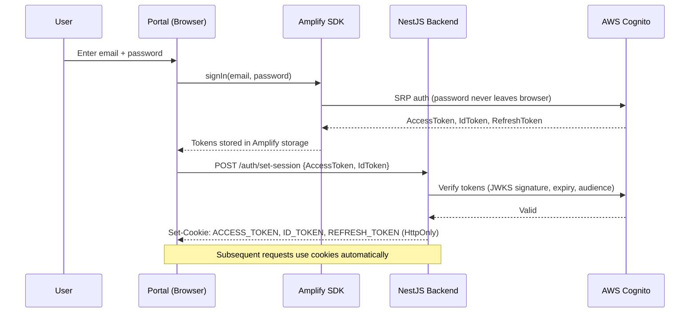
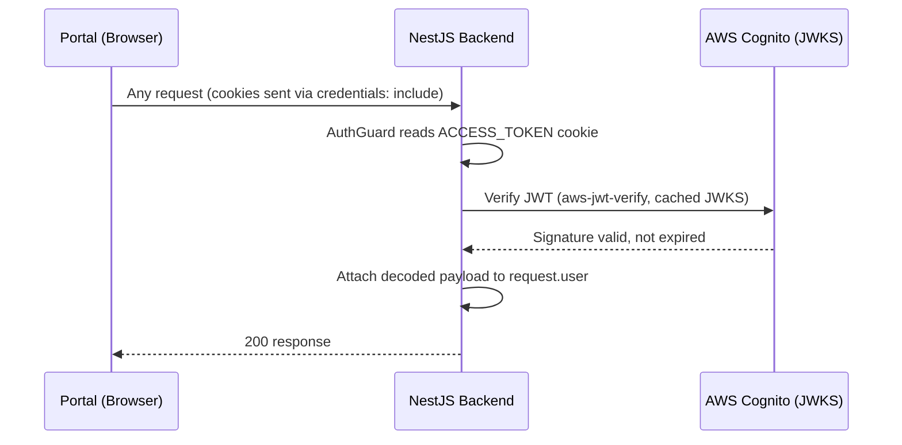
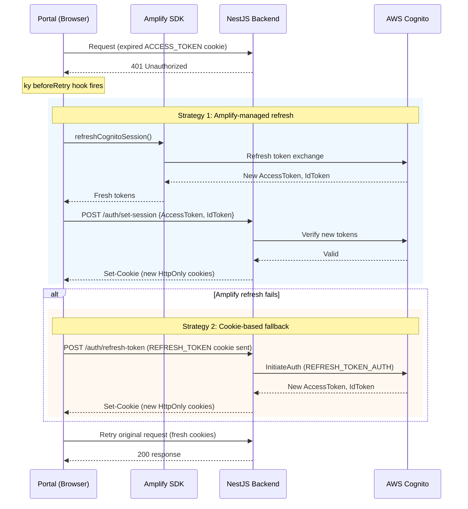
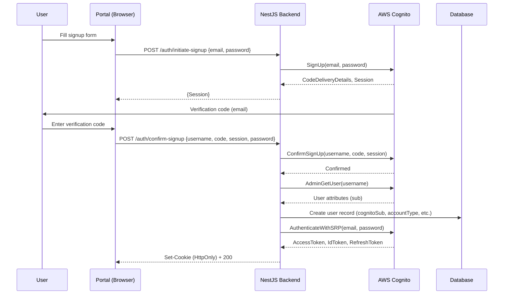
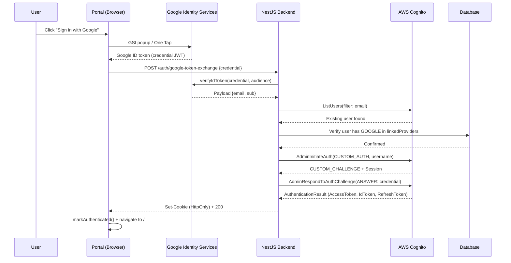
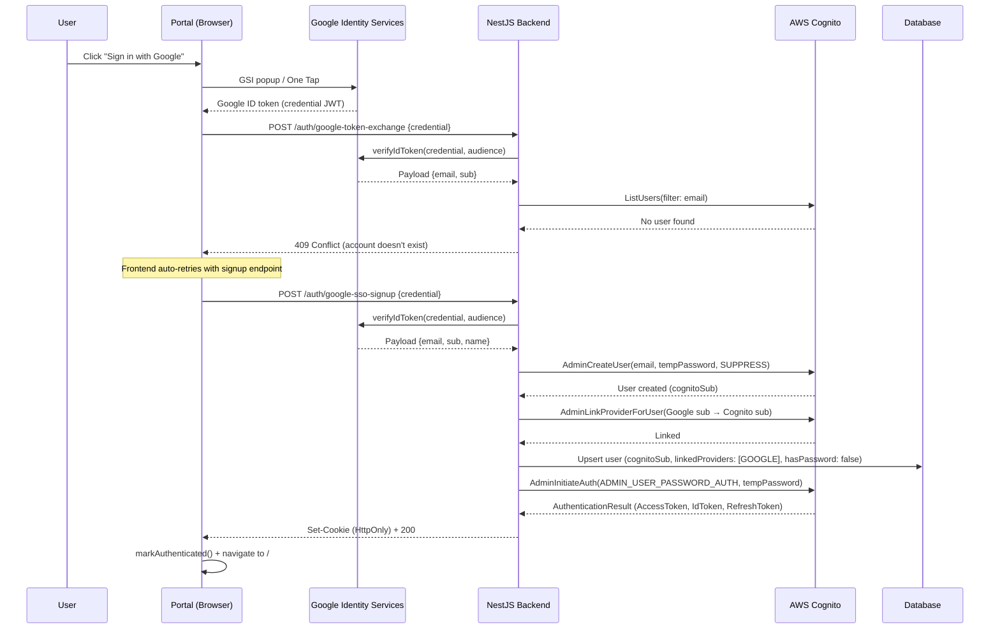
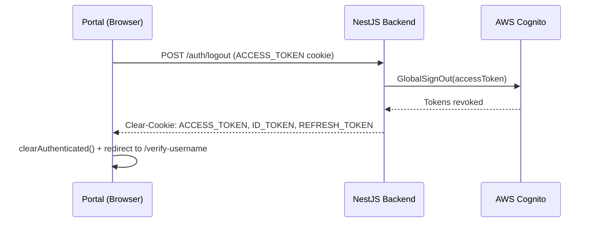

# Auth Sequence Diagrams

## Primary Login (Amplify SRP)

## Authenticated API Request

## Token Refresh (401 intercepted)

## Signup + Auto-Login

## Google Sign-In (existing account)

## Google Sign-Up (new account)

## Logout

